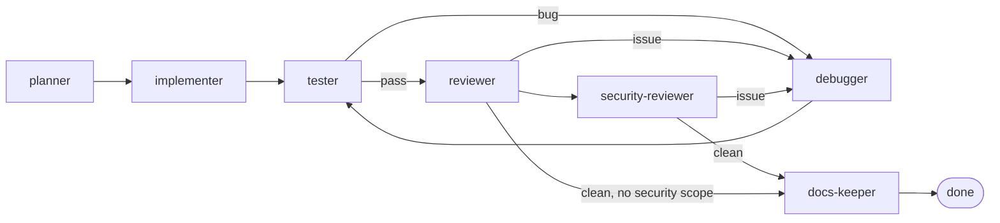

---
tags:
  - hackathon
  - architecture
---

# System Architecture

This repo has two architectures: the **environment** that every laptop runs, and the
**target app** the team builds at the event. The guiding discipline for both is Ponytail:
the smallest complete change that works, never cutting validation, security, or accessibility.

- Code, UI, security, and docs rules: [CLAUDE.md](../CLAUDE.md)
- Human timeline and roles: [TEAM-GUIDE.md](../TEAM-GUIDE.md)
- Decision records: [DECISIONS.md](DECISIONS.md)

---

## 1. Environment architecture

Everything a teammate needs is checked into the repo, so every laptop is identical after
`CLAUDE-SETUP-PROMPT.md` runs.

```
repo root
├── CLAUDE.md                 # rules for every agent (human + AI)
├── CLAUDE-SETUP-PROMPT.md    # one-shot setup, executed by Claude Code
├── TEAM-GUIDE.md             # human team guide + 75-min timeline
├── .mcp.json                 # shared MCP servers (public URLs, no secrets)
├── .gitignore / .env.example # secrets stay local; example has empty values; .obsidian/ ignored
├── scripts/health-check.mjs  # one-command check: Vercel, Supabase, docs vault, API contract
├── docs/                     # ARCHITECTURE, DECISIONS, CHANGELOG, openapi.json (API contract)
└── .claude/
    ├── settings.json         # shared permissions, enabled plugins, hooks
    ├── hooks/                # format-prettier.sh (Prettier on Edit/Write), notify.sh (desktop alert)
    ├── agents/               # the seven subagents (the loop) and their preloaded skills
    └── skills/               # /hackathon-demo-ready, /pr-handoff, /caveman, ...
```

**MCP servers** ([`.mcp.json`](../.mcp.json)) — public endpoints only; OAuth is a per-laptop
`/mcp` step, never a committed token:

| Server | Transport | Auth | Used by |
| --- | --- | --- | --- |
| Vercel | HTTP `https://mcp.vercel.com` | `/mcp` OAuth | deploy, env, logs |
| Supabase | HTTP `https://mcp.supabase.com/mcp` | `/mcp` OAuth | DB, auth, RLS |
| Playwright | stdio `npx -y @playwright/mcp@latest` | none | UI verification |
| GitHub | `github@claude-plugins-official` plugin | `/mcp` OAuth | PRs, issues |
| Obsidian | `obsidian@obsidian-skills` plugin; this repo is the vault | none | docs vault; docs-keeper preloads `obsidian-markdown` (skills only, no MCP) |

Team memory lives in git (`README.md`, `docs/DECISIONS.md`, `docs/CHANGELOG.md`,
`docs/openapi.json`). The repo itself is the team's Obsidian vault (see
[Docs in Obsidian](../README.md#docs-in-obsidian)), so nothing lives only in one person's
private vault. The format rules are in the CLAUDE.md Docs rules.

---

## 2. Target app architecture

> [!NOTE]
> The target app is **Bahir**, an accessible reports product. Its docs are in [docs/bahir/BAHIR.md](bahir/BAHIR.md).

The stack is fixed so no time is lost choosing it; only the product is unknown until the event.

```
Browser (he / en, RTL + LTR)
  │  styled-components theme · shared primitives in src/components/ui/
  ▼
Next.js App Router on Vercel
  │  Server Components · Route Handlers · Server Actions
  │  zod validation at every trust boundary · secrets from process.env
  ▼
Supabase (Postgres + Auth)
     Row Level Security on every table · parameterized queries only
```

- **Frontend** — Next.js App Router; styled-components with one shared theme (all colors,
  spacing, fonts from the theme); shared primitives in `src/components/ui/`; no Tailwind,
  no shadcn, no inline styles, no raw HTML in feature components.
- **i18n / RTL** — Hebrew and English are first-class. Every user-facing string is an i18n
  key (no hardcoded text, no fallback strings). Use logical CSS (`margin-inline-start`, not
  `margin-left`). RTL is verified in the browser, not assumed.
- **Backend** — server code in Route Handlers or Server Actions; every request body/query
  validated with zod; auth checked on every non-public route. Routes are contract-first: the
  planner writes them into `docs/openapi.json` (OpenAPI 3.1) before they are built, and the
  app serves that file with Swagger UI once it is scaffolded.
- **Data** — Supabase Postgres with RLS on every table; parameterized queries only; no
  string-built SQL.
- **Secrets** — only in env vars, read on the server; missing env vars fail fast. No
  `NEXT_PUBLIC_*` secret, no PII or tokens in logs.
- **Deploy** — `npm run build` must stay green because Vercel deploys run it. `vercel` for
  previews; `vercel --prod` by the merge captain only.

### Trust boundaries

1. **Browser → server** — never trust the client. Validate input, check auth, keep secrets server-side.
2. **Server → Supabase** — RLS is the backstop; parameterized queries only.
3. **Untrusted text → model/HTML** — treat as data: no instruction-following, no
   `dangerouslySetInnerHTML` on model output.

---

## 3. The agent pipeline



Each human runs this loop on their **own slice and directories** — never the same files in
parallel. Plan together first, write the agreed interfaces in `docs/DECISIONS.md`, hand off
with `/pr-handoff`, and run `/hackathon-demo-ready` before presenting.

---

## 4. Roles & rules (with Ponytail advice)

Full definitions live in [`.claude/agents/`](../.claude/agents); this is the summary with the
Ponytail lens for each.

**Preloaded skills.** Each agent's `skills:` frontmatter injects these skills at startup:

| Agent | Preloads | Why |
| --- | --- | --- |
| planner | `ponytail:ponytail` | Plan the smallest demoable slice |
| implementer | `ponytail:ponytail` | Reuse before adding; minimum code |
| tester | `caveman` | Short internal report; test files stay plain English |
| reviewer | `ponytail:ponytail-review`, `caveman` | Ponytail checklist under the 80+ filter; short report |
| security-reviewer | none | Attack descriptions need full detail |
| debugger | `ponytail:ponytail`, `caveman` | Smallest root-cause fix; short report; docs stay plain |
| docs-keeper | `obsidian:obsidian-markdown` | Obsidian-format docs, with standard links instead of wikilinks |

Caveman applies only to reports handed back to the main session. Docs, code, commits, and
user-facing strings are never written in caveman.

### planner
- **Mandate:** turn a goal into the smallest demoable slice. Name exact files, the interfaces
  between slices (types, routes, request/response shapes), the i18n keys (he + en), env var
  names (names only), and one runnable check per step. Keep it Vercel-deployable.
- **May:** read anything; write only planning and docs files.
- **May not:** implement product code, change tests (beyond listing them), deploy, or commit.
- **Done:** a plan the implementer can follow, with files, risks, and a test plan, recorded in
  `docs/DECISIONS.md`. **Next:** implementer.
- **Ponytail:** the cheapest slice that can be demoed wins. First ask whether it needs to
  exist at all; prefer existing project patterns over new structure.

### implementer
- **Mandate:** build one accepted slice. Read the files you touch and a similar existing file
  first; look up every library API in the installed version's docs (never from memory); write
  the failing test first for logic. Then type-check, lint, `npm test`, `npm run build` and fix
  every failure.
- **May:** edit app source, add tests for the slice, run the project, update docs.
- **May not:** change architecture (send back to planner), add unplanned features, claim done
  without running the commands, or commit secrets.
- **Done:** the slice works, commands are quoted, docs updated. **Next:** tester.
- **Ponytail:** reuse before you add — repo code, then platform/stdlib, then an installed
  dependency, then minimum new code. No speculative options or "for later" code.

### tester
- **Mandate:** prove the slice with commands, not claims. Exercise the demo path in English
  (LTR) and Hebrew (RTL) with Playwright or the browser. Record exact commands and results.
- **May:** add/edit test files, run test and dev commands, drive the UI.
- **May not:** change product source to make tests pass (hand off instead); print secrets.
- **Done:** failing and passing evidence is quoted. **Next:** reviewer if green, debugger if a
  product bug remains.
- **Ponytail:** one runnable check (a test, a curl, a Playwright step) is worth more than any
  assurance. Note coverage gaps rather than faking them.

### reviewer
- **Mandate:** read-only review of the git diff for correctness, security, and CLAUDE.md
  (styled-components only, no raw HTML, theme values, he+en i18n keys, RTL-safe CSS, no
  invented APIs, handled errors/empty states, nothing that breaks `npm run build`). Score each
  issue 0–100; report only confidence 80+. Give file, line, why, and a concrete fix.
- **May:** read and search. **May not:** edit, run state-changing commands, or deploy.
- **Done:** a short report or a clean statement. **Next:** debugger/implementer if issues, else
  security-reviewer or docs-keeper.
- **Ponytail:** scope creep and speculative code are defects, not extras. Don't nitpick style
  unless CLAUDE.md forbids it.

### security-reviewer
- **Mandate:** read-only pass before merging anything touching auth, routes, server actions,
  Supabase/RLS, env vars, uploads, or model calls. Check, in order: auth + RLS on every
  non-public path; server-side validation of every body/query; secrets only in server
  `process.env`; parameterized queries; untrusted text treated as data; no PII/tokens in logs
  or client errors. Report only confidence 80+ with file, line, the attack in one sentence, and
  a fix.
- **May:** read and search. **May not:** edit, run state-changing commands, or print secrets.
- **Done:** issues with fixes, or "clean". **Next:** debugger if issues, else docs-keeper.
- **Ponytail:** security is on the never-cut list — a smaller diff never justifies dropping an
  auth check, RLS, or validation.

### debugger
- **Mandate:** reproduce first, then fix the smallest root cause. Add a regression test that
  fails before the fix and passes after. Write the root cause into `docs/DECISIONS.md` or
  `docs/CHANGELOG.md`.
- **May:** edit product/test files to fix the defect, run demonstrating commands.
- **May not:** add features, do drive-by refactors, or skip a failing reproduction.
- **Done:** the previously failing case passes, commands quoted. **Next:** tester (must re-run).
- **Ponytail:** grep every caller and fix the cause once in shared code; resist refactoring
  around the bug.

### docs-keeper
- **Mandate:** make README, CLAUDE.md, `docs/DECISIONS.md`, and `docs/CHANGELOG.md` match the
  repo as it is. Fix stale commands, missing setup steps, and undocumented decisions.
- **May:** edit documentation files. **May not:** change logic, tests, or config.
- **Done:** a new teammate can run the project from the README; CHANGELOG and DECISIONS cover
  the slice. **Next:** done.
- **Ponytail:** if something is unknown, write "unknown" — never invent docs to fill a gap.

### Human roles (max 4)

| Role | Owns | Ponytail advice |
| --- | --- | --- |
| **Frontend** | UI, components, the visual demo path | Compose from `src/components/ui/` primitives; add one there only when missing. |
| **Backend / data** | API, database, auth | One shared Supabase project; RLS and validation before features. |
| **AI / prompts** | Model calls, prompts, library docs | Check installed-version docs; never invent an API. Keep prompts minimal. |
| **Demo / pitch** | Deploy, README, 2-minute script; merge captain | `main` stays demoable; if a conflict burns the demo, keep what already runs. |

Rules that bind every human: `main` stays demoable; short branches (`feat/<name>`); no two
people edit the same file; one merge captain; no force-push to `main`; never commit `.env`,
keys, or tokens.
